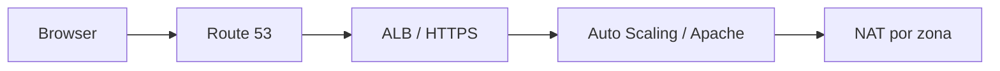

# Website estático com CloudFormation e CodeBuild

Laboratório de um website servido por Apache em EC2 privadas, atrás de um ALB HTTPS, com DNS no Route 53. Os ficheiros do website vêm de [Festava Live](https://github.com/edgarjose/festava_live).

## Arquitetura



O diagrama mostra os componentes principais. Route 53 resolve o nome; não encaminha o tráfego HTTP. Não existe uma base de dados neste projeto.

## Ficheiros

- `master.yaml`: coordena VPC, NAT, ALB, ASG e registo DNS.
- `vpc.yaml` e `natgateway.yaml`: rede em duas zonas e saída das sub-redes privadas.
- `alb.yaml`: redirect HTTP para HTTPS, certificado e target group.
- `asg.yaml`: Amazon Linux 2023, instalação do Apache e publicação dos ficheiros.
- `route53.yaml`: alias `www.DOMINIO` para o ALB.
- `buildspec.yml`: valida os templates, empacota os filhos e implementa a stack.

## Pré-requisitos

- AWS CLI v2 e permissões para CloudFormation, EC2, Auto Scaling, ELB, S3, Route 53 e leitura dos parâmetros públicos SSM.
- Bucket S3 de artefactos na região da implementação.
- Uma zona pública Route 53 já existente para o teu domínio.
- Certificado ACM emitido **na mesma região do ALB**, cobrindo `www.DOMINIO`. O lab não emite nem valida o certificado.
- Região com pelo menos duas zonas disponíveis.

## Implementar manualmente

Exemplo em Bash; substituir o bucket, domínio e ARN:

```bash
export AWS_DEFAULT_REGION=us-east-1
export ARTIFACT_BUCKET=SEU_BUCKET_PRIVADO
export DOMAIN_NAME=example.com
export CERTIFICATE_ARN=ARN_DO_SEU_CERTIFICADO_REGIONAL
aws sts get-caller-identity
aws cloudformation package --template-file master.yaml --s3-bucket "$ARTIFACT_BUCKET" --output-template-file packaged.yaml
aws cloudformation deploy --template-file packaged.yaml --stack-name practical-static-lab --parameter-overrides "DomainName=$DOMAIN_NAME" "ACMCertificateArn=$CERTIFICATE_ARN"
aws cloudformation describe-stacks --stack-name practical-static-lab --query 'Stacks[0].Outputs'
```

Os caminhos locais dos nested templates são convertidos em URLs S3 por `package`. Não implementar o `master.yaml` sem empacotar. Os parâmetros não contêm referências à conta original do autor.

## Executar no CodeBuild

Criar um projeto CodeBuild ligado a este repositório, com uma imagem gerida Linux que disponibilize AWS CLI. Usar o buildspec da raiz e uma service role com acesso aos recursos do laboratório.

Configurar as variáveis `ARTIFACT_BUCKET`, `DOMAIN_NAME`, `CERTIFICATE_ARN` e, opcionalmente, `STACK_NAME`. O nome por defeito é `practical-static-codebuild`. Nenhuma destas variáveis substitui credenciais IAM.

O projeto CodeBuild, a ligação ao GitHub e uma eventual CodePipeline não são criados pelos templates incluídos. O buildspec começa na raiz do checkout e publica os templates filhos antes do deploy.

## Verificar e diagnosticar

Esperar a criação da stack, confirmar dois targets saudáveis e abrir o output `WebsiteURL`. Verificar o redirect HTTP → HTTPS e o certificado apresentado pelo browser.

Se os targets não ficarem saudáveis, consultar os eventos do ASG e os logs de UserData da instância. A instalação depende de saída por NAT; o root template cria essa dependência antes do ASG.

A AMI SSM e a branch `main` do website são mutáveis. Fixar versões se o objetivo for reproduzir exatamente o mesmo build. Os formulários do template não têm backend.

## Custos e limpeza

O lab mantém pelo menos duas EC2, dois NAT Gateways, um ALB e IPv4 públicos, além dos custos de DNS/S3/CodeBuild. O grupo SSH de exemplo tem uma regra ampla; não o associar a hosts públicos sem a restringir.

Eliminar a stack principal quando o ensaio terminar:

```bash
aws cloudformation delete-stack --stack-name practical-static-lab
aws cloudformation wait stack-delete-complete --stack-name practical-static-lab
```

No CodeBuild, usar o nome efetivamente definido em `STACK_NAME`. O certificado, a hosted zone, o bucket de artefactos e o projeto CodeBuild são pré-requisitos externos e não são apagados pela stack. Rever recursos dedicados e custos restantes.

[Documentação de nested stacks](https://docs.aws.amazon.com/AWSCloudFormation/latest/UserGuide/using-cfn-nested-stacks.html)
